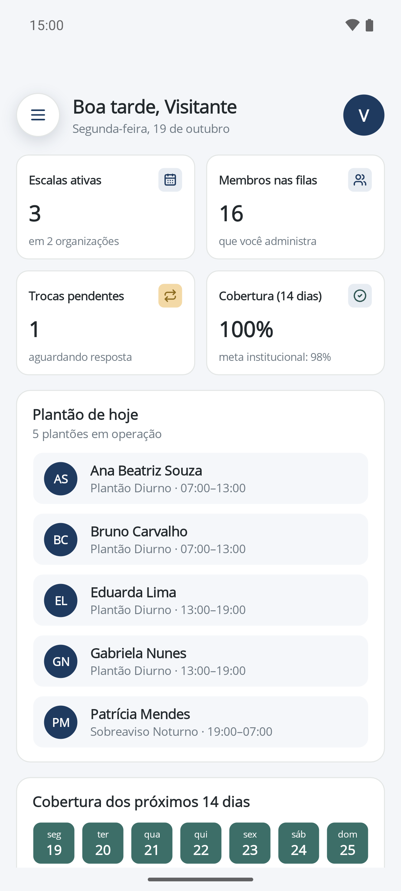
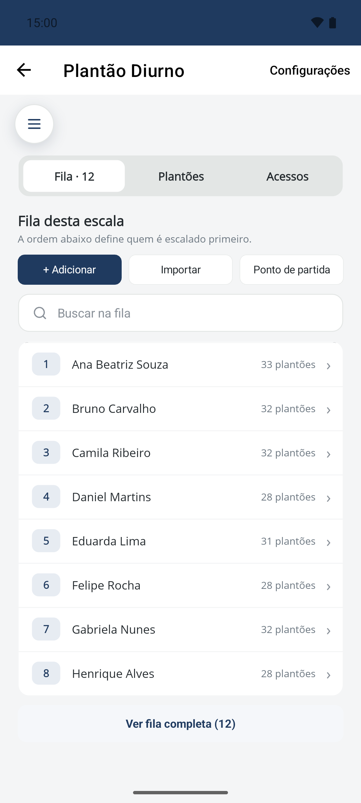
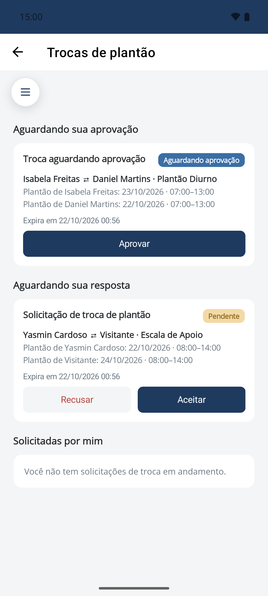
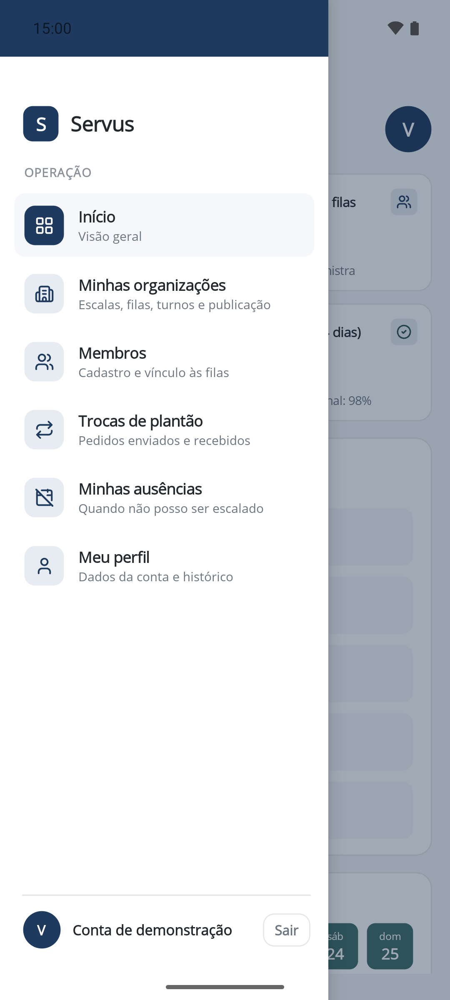
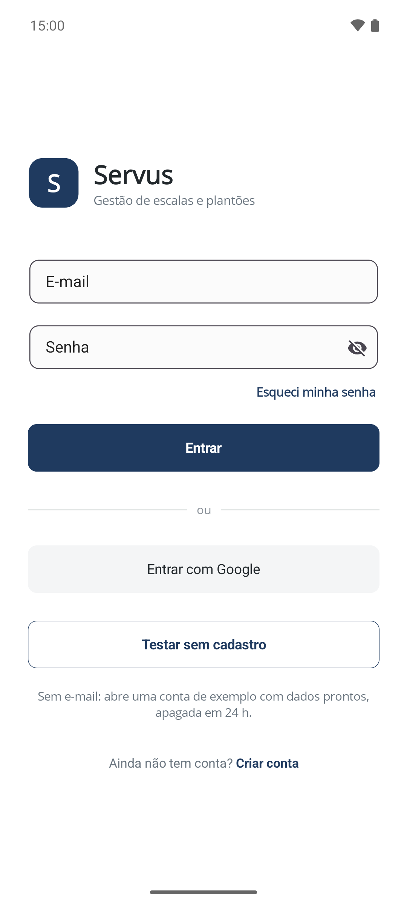

<div align="center">


# Servus

**Escalas de plantão justas, sem planilha.**

Gere a escala, distribua os plantões em fila, troque turnos com colegas e saiba na hora
quando algo muda — tudo no celular.

[](https://github.com/DouglasOliveiraC/servus.mobile/releases/latest)
[](#instalação)
[](https://dotnet.microsoft.com/)
[](https://learn.microsoft.com/dotnet/maui/)
[](https://learn.microsoft.com/dotnet/csharp/)
[](#transparência-e-privacidade)
[](#por-que-o-código-é-aberto)

[**Baixar o app**](https://github.com/DouglasOliveiraC/servus.mobile/releases/latest) ·
[Site](https://servus.newsight.com.br/) ·
[Transparência](#transparência-e-privacidade) ·
[Para desenvolvedores](#para-desenvolvedores)

</div>

---

## O que é

O Servus organiza escalas de plantão de equipes que trabalham em rodízio. Quem administra monta
a escala uma vez; o sistema distribui os plantões pela fila, respeita ausências e feriados e
mantém a divisão justa ao longo do tempo. Quem está na escala acompanha os próprios plantões,
pede trocas e é avisado do que muda.

<div align="center">
<table>
<tr>
<td align="center"><br /><sub><b>Painel do dia</b></sub></td>
<td align="center"><br /><sub><b>Fila da escala</b></sub></td>
<td align="center"><br /><sub><b>Trocas de plantão</b></sub></td>
<td align="center"><br /><sub><b>Tudo a um toque</b></sub></td>
</tr>
</table>
<sub>Telas da conta de demonstração — nomes e dados fictícios.</sub>
</div>

## Funcionalidades

<table>
<tr>
<td width="50%" valign="top">

### Para quem está na escala

- **Painel do dia** — próximo plantão, quem está de serviço hoje e o resumo do mês
- **Trocas de plantão** — peça a um colega, aceite ou recuse e acompanhe a aprovação
- **Ausências** — informe férias e impedimentos antes de a escala ser gerada
- **Notificações** — troca pedida, aceita ou aprovada e escala publicada, mesmo com o app fechado
- **Histórico pessoal** — todos os plantões que você já cumpriu, em qualquer organização

</td>
<td width="50%" valign="top">

### Para quem administra

- **Organizações e escalas** — turnos, equipe por dia e intervalo mínimo entre plantões
- **Filas justas** — rodízio que lembra quem já serviu, inclusive em feriados
- **Importação de lista** — cole a lista de membros e a fila está pronta
- **Geração e publicação** — gere a escala, ajuste à mão e publique quando estiver pronta
- **Aprovação de trocas e ausências** — nada muda na escala sem passar por você
- **Convites por código** — cada pessoa entra na organização pelo próprio celular

</td>
</tr>
</table>

<table>
<tr>
<td width="200" align="center"></td>
<td>

**Quer só conhecer?** Na tela de entrada, toque em **Testar sem cadastro**: você recebe uma
organização de exemplo com dados prontos, apagada em 24 horas. Sem e-mail, sem senha.

</td>
</tr>
</table>

## Instalação

O Servus é distribuído diretamente por aqui, fora da Play Store.

1. No celular, abra a [**versão mais recente**](https://github.com/DouglasOliveiraC/servus.mobile/releases/latest)
   e baixe o arquivo `servus-<versão>.apk`.
2. Abra o arquivo baixado. Na primeira vez, o Android pede para **permitir a instalação de apps
   desta fonte** (o navegador ou o gerenciador de arquivos) — autorize e volte.
3. Toque em **Instalar**.

**Atualizações** seguem o mesmo caminho: baixe o APK novo e instale por cima. Seus dados e seu
login são mantidos.

> Requer **Android 6.0** ou mais novo. No iPhone ou no computador, use o
> [site](https://servus.newsight.com.br/).

## Por que o código é aberto

Um app instalado fora da loja pede confiança. Em vez de pedir, mostramos: todo o código que roda
no seu celular está aqui, e qualquer pessoa pode conferir o que ele faz.

Isto **não é um projeto de código aberto** — o código pode ser lido, compilado e auditado, mas
não copiado nem reutilizado. Veja a [licença](LICENSE).

## Transparência e privacidade

### Permissões

| Permissão | Para quê |
|---|---|
| Internet e estado da rede | Falar com o servidor do Servus |
| Notificações | Avisar sobre trocas e escalas |
| `c2dm.permission.RECEIVE` e `WAKE_LOCK` | Receber notificações push (incluídas pela biblioteca do Firebase) |

Nenhuma outra. O app **não** acessa contatos, localização, câmera, microfone, fotos ou arquivos.
Confira em [`AndroidManifest.xml`](Platforms/Android/AndroidManifest.xml).

### Para onde o app se conecta

| Destino | O que trafega |
|---|---|
| **API do Servus** — [`ApiConfig.cs`](Services/Http/ApiConfig.cs) | Seus dados de escala, sempre por HTTPS |
| **Firebase Cloud Messaging** (Google) | Notificações com texto genérico ("Nova solicitação de troca"), sem nomes nem datas — os detalhes o app busca na API |
| **Azure Application Insights** (Microsoft) | Erros e tempos de resposta do app, sem e-mail, senha ou token — [`Services/Telemetry`](Services/Telemetry) |
| **Google** | Só se você escolher **Continuar com Google** na entrada |

### Suas credenciais

- A **senha** nunca é guardada no celular.
- O **token de sessão** fica no armazenamento seguro do Android
  ([`SecureTokenStore.cs`](Services/Auth/SecureTokenStore.cs)) e fora do backup automático.
- Ao **sair da conta**, o registro do celular para notificações é apagado do servidor
  ([`PushRegistrationService.cs`](Services/Push/PushRegistrationService.cs)).

### O APK é mesmo deste código?

Cada versão é compilada pelo GitHub Actions a partir do código marcado com a tag da versão
([workflow](.github/workflows/release-android.yml)) e publicada com um **atestado de
procedência assinado pelo GitHub**. Para conferir o arquivo que você baixou:

```bash
gh attestation verify servus-<versão>.apk --repo DouglasOliveiraC/servus.mobile
```

Sem a CLI do GitHub, compare o hash do arquivo com o `.sha256` publicado na mesma versão.

> **O que não dá para auditar aqui:** o servidor. O app mostra e envia o que a API devolve e
> recebe; o processamento no backend não faz parte deste repositório.

## Para desenvolvedores

### Stack

| | |
|---|---|
| Plataforma | .NET 10 · .NET MAUI · C# |
| Arquitetura | MVVM com [CommunityToolkit.Mvvm](https://github.com/CommunityToolkit/dotnet) |
| Componentes | [Syncfusion .NET MAUI](https://www.syncfusion.com/maui-controls) |
| Tempo real | ASP.NET Core SignalR |
| Notificações | Firebase Cloud Messaging |
| Telemetria | OpenTelemetry → Azure Monitor |

### Rodando localmente

Requisitos: [.NET 10 SDK](https://dotnet.microsoft.com/download) com o workload `maui-android`
e um emulador ou aparelho Android.

```bash
dotnet workload install maui-android
dotnet build -f net10.0-android -t:Run
```

Em **Debug** o app fala com a API em `http://10.0.2.2:5080/` (a sua máquina vista de dentro do
emulador); em **Release**, com a API de produção.

### Configuração opcional

Nada abaixo é necessário para compilar — sem cada item, só o recurso correspondente fica
desligado. Nenhum deles é versionado.

| Item | Onde | Sem ele |
|---|---|---|
| `SYNCFUSION_LICENSE_KEY` | Variável de ambiente no build | Os componentes exibem o aviso de licença |
| `APPINSIGHTS_CONNECTION_STRING` | Variável de ambiente no build | Sem telemetria |
| `google-services.json` | Raiz do projeto | Sem notificações push |

As duas variáveis são gravadas no assembly durante o build (target `GenerateBuildSecrets` no
[`.csproj`](Servus.Mobile.csproj)), num arquivo gerado em `obj/`.

### Estrutura

```
Features/        Telas e ViewModels, uma pasta por área (Home, Swaps, Admin, …)
Services/        Clientes da API, sessão, tempo real, push e telemetria
Controls/        Componentes visuais reutilizáveis
Converters/      Conversores de binding do XAML
Platforms/       Código específico do Android (activity, serviço do Firebase)
Resources/       Estilos, cores, fontes, ícone e splash
```

### Publicando uma versão

Uma tag `v*` gera o APK assinado e cria a release:

```bash
git tag v1.0.0
git push origin v1.0.0
```

Secrets do repositório (*Settings → Secrets and variables → Actions → Repository secrets*):

| Secret | Conteúdo |
|---|---|
| `ANDROID_KEYSTORE_BASE64` | Keystore de assinatura, em base64 |
| `ANDROID_KEYSTORE_PASSWORD` · `ANDROID_KEY_ALIAS` · `ANDROID_KEY_PASSWORD` | Acesso à keystore |
| `GOOGLE_SERVICES_JSON_BASE64` | `google-services.json` do Firebase, em base64 |
| `SYNCFUSION_LICENSE_KEY` · `APPINSIGHTS_CONNECTION_STRING` | Licença e telemetria |

> A keystore e o identificador do app (`br.com.newsight.servus`) são a identidade do Servus no
> Android: o celular só aceita uma atualização assinada pela mesma chave. Perder a keystore
> obriga todos a desinstalar e instalar de novo — guarde-a com backup, fora do repositório.

---

<div align="center">

Feito pela [**Newsight**](https://newsight.com.br) · © 2026 · [Todos os direitos reservados](LICENSE)

</div>
